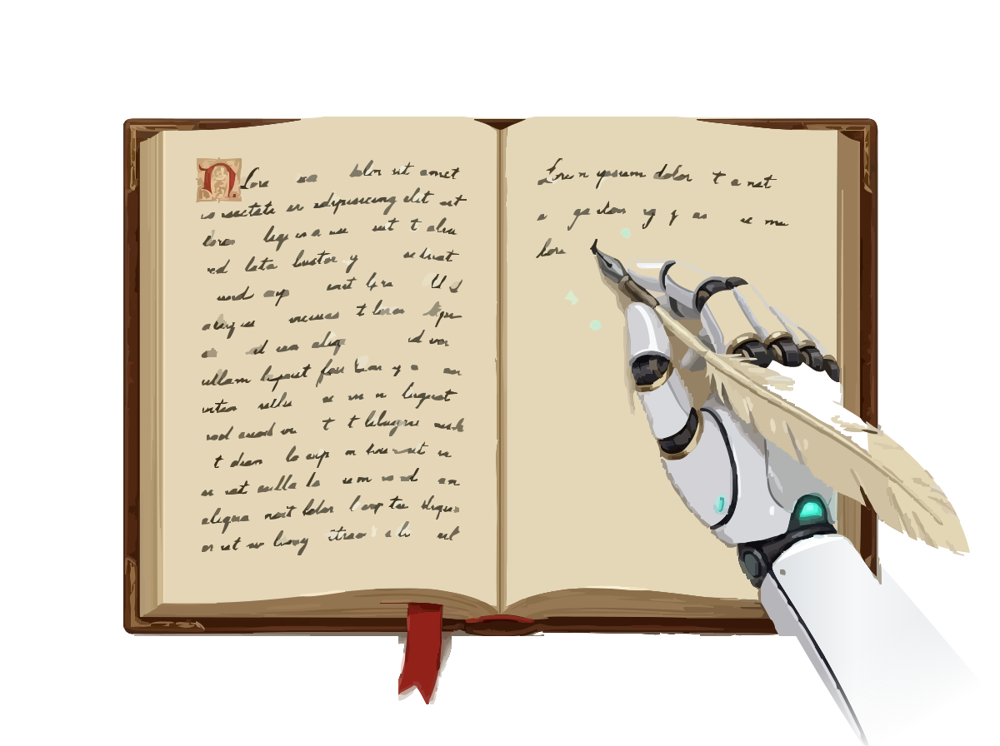

<p align="center"></p>

<h1 align="center">NovelForge</h1>

<p align="center">A choose-your-own visual novel, written as you play.</p>

NovelForge is a single-player story game. You build a world and a character, then act and speak only as that character, while a text model plays the Narrator: it runs the story, voices everyone else, keeps track of the world, and rolls the dice when what you try could fail. An image model draws the Cover, portraits and scenes as the story goes.

It runs on your own computer and talks to models you choose. Bring an OpenAI-compatible text API (OpenRouter, DeepInfra, a local server) and, for pictures, OpenRouter or your own ComfyUI.

## Features

- **New Story wizard:** choose a Theme, write or generate the world and your character, and draw the Cover and portraits before you start.
- **Play:** each Turn is your move and the Narrator's reply, streamed as it's written. Ask the Narrator a question, have it decide for you, or tell it to change the world.
- **Memory:** a Journal of what your character knows, Loose Ends, the people met and Chapters, kept by the Narrator and editable by you.
- **Undo anything:** edit, rewrite or regenerate a reply, or revert to any earlier Message. Every Save is one SQLite file you can duplicate, export and import.
- **Pictures:** Scene Images when the scene changes, pictures on request, and a Gallery to redraw, nudge or replace any of them with your own.

## Quick Install

Download your system's file from the [Releases](https://github.com/brianh014/novelforge/releases/latest) page. Each system has two:

- **NovelForge** is the app: it opens in your browser, for this computer only, and you end it with Quit in the Menu.
- **NovelForge Server** serves the whole network and opens no browser, so it runs headless too. Its log goes to the terminal, and stopping it (closing the window, or Ctrl+C) stops the server. Browse to it from any device at `http://<its address>:4600/`; it lists its addresses as it starts.

Both use port 4600. Open **Settings** first to enter your text model's address, model and key (see [Recommended settings](#recommended-settings)). The downloads aren't signed yet, so Windows and macOS warn the first time you open one.

### Windows

1. Download `NovelForge-Windows.zip` (or `NovelForge-Server-Windows.zip`).
2. Unzip it into a folder of its own, such as `Documents\NovelForge`. Your Saves, Settings and logs are kept in that folder, beside the program.
3. Open `NovelForge.exe`. If Windows says it protected your PC, choose **More info**, then **Run anyway**.

### macOS

1. Download `NovelForge-Mac-AppleSilicon.tar.gz` for an M-series Mac, or `NovelForge-Mac-Intel.tar.gz` for an Intel one (the `NovelForge-Server-Mac-…` files for the Server).
2. Open the file to unpack `NovelForge.app`, and drag it to Applications. Your Saves, Settings and logs are kept in `~/Library/Application Support/NovelForge`.
3. Open it. The first time, macOS refuses it: open **System Settings → Privacy & Security**, choose **Open Anyway** beside NovelForge, and confirm.

### Linux

1. Download and unpack it into a folder of its own, for x64. On a machine with no desktop, such as a server reached over SSH, use the Server. Use `NovelForge-Server-Linux.tar.gz` for the Server:

   ```bash
   mkdir -p ~/NovelForge && cd ~/NovelForge
   curl -fL -o NovelForge-Linux.tar.gz https://github.com/brianh014/novelforge/releases/latest/download/NovelForge-Linux.tar.gz
   tar -xzf NovelForge-Linux.tar.gz && rm NovelForge-Linux.tar.gz
   ```

2. Your Saves, Settings and logs are kept in that folder, beside the program.
3. Run `~/NovelForge/NovelForge`, which opens your browser with `xdg-open` (if none opens, go to `http://127.0.0.1:4600/`). For the Server, run `~/NovelForge/NovelForge-Server` and browse to one of the addresses it prints.

#### Running the Server in the background

To keep the Server running after you log out, and start it again when the machine restarts, make it a systemd service. Run this as the user who unpacked it, from any folder:

```bash
sudo tee /etc/systemd/system/novelforge.service >/dev/null <<EOF
[Unit]
Description=NovelForge Server
After=network-online.target
Wants=network-online.target

[Service]
ExecStart=$HOME/NovelForge/NovelForge-Server
User=$(id -un)
Restart=on-failure

[Install]
WantedBy=multi-user.target
EOF
sudo systemctl daemon-reload
sudo systemctl enable --now novelforge
```

| To | Run |
| --- | --- |
| See whether it's running, and its addresses | `systemctl status novelforge` |
| Follow its log | `journalctl -u novelforge -f` (also kept in `~/NovelForge/logs`) |
| Restart it | `sudo systemctl restart novelforge` |
| Stop it, and keep it from starting at boot | `sudo systemctl disable --now novelforge` |

### Updating

When a new version is out, the Menu says so. Choose **Install**, and NovelForge downloads it, restarts and comes back to the Menu, on every system and for the Server too. Your Saves and Settings stay as they are, and if the new version fails to start, the old one comes back. To check, NovelForge asks GitHub for the newest release now and then; nothing else is sent.

You can also update by hand: download the new version and unpack it over the old one, with NovelForge closed (on a Mac, replace `NovelForge.app` in Applications).

## Using NovelForge

The **Reader's Guide** on the Menu explains everything in the app: making a story, playing, changing what happened, the Journal, pictures, Saves, every setting, and answers to common problems.

## Running from source

You need [Bun](https://bun.sh) 1.4 or later.

```bash
bun install
bun start
```

`bun start` serves NovelForge on port 4600 and opens it in your browser. Open **Settings** to enter your text model's address, model and key, and optionally an image model. To update, run `git pull` and `bun install`. Your Saves, Settings and logs stay in the project folder, which git ignores.

To try it with no model and no key, run it with stand-ins:

```bash
bun src/main.ts --fake --open
```

| Option | What it does |
| --- | --- |
| `--fake` | Uses a stand-in Narrator and image model, with their own Saves and Settings under `fake/`. |
| `--open` | Opens the browser once the server is up. |
| `--app` | Runs as the desktop app: this computer only, with Quit in the Menu. |
| `--server` | Runs as a server for the network, even from a built download. |
| `PORT` | The port to listen on (default `4600`). |
| `HOST` | The address to listen on (default `0.0.0.0` for a server, `127.0.0.1` for the app). |

`bun run install-launcher` adds a NovelForge shortcut to your desktop or app menu. `bun run release` builds the one-file downloads into `dist/release`. `bun run publish-release` tags the commit with `package.json`'s version, builds the downloads and uploads them as a GitHub release with the [GitHub CLI](https://cli.github.com) (`gh`), signed in as you; a version with a hyphen, such as `0.2.0-alpha.1`, is a pre-release, which the Menu's Install skips.

> **A server on the network has no accounts.** Anyone who can reach it can play, change Settings and spend your saved keys. Keep it on a network you trust, or set `HOST=127.0.0.1`.

## Recommended settings

### Text: a hosted API

Use a hosted text API, such as OpenRouter or any other OpenAI-compatible provider. Every Turn sends the Narrator the newest Messages in full, plus the world, the Journal and the Old Memories, so a long story's prompt grows past 30,000 tokens. Large hosted models take all of it, keep the story straight and return the Narrator's JSON first time, for pennies a Turn. Staying on one provider keeps its prompt cache, which makes each Turn cheaper.

A local model works too: choose **Local / OpenAI server** and give the address of Ollama (`http://localhost:11434/v1`), LM Studio (`http://localhost:1234/v1`) or another OpenAI-compatible server. It suits short stories, play with nothing leaving your computer, and trying things out. A 10 GB GPU fits a model of about 12B at Q4 with a 16,000-token context, so the Narrator sees much less of a long story, and a Turn can take a minute. To get the most from it:

- Set the context length in the server, such as `PARAMETER num_ctx 16384` in an Ollama Modelfile. Ollama's default is small, and it cuts the prompt without saying so.
- In Settings → Text, set **Longest reply, in tokens** to about 3000 and **Recent Messages** to 40. The server keeps room in its context for the longest reply, so a high limit leaves less for the story.
- Leave the server's memory settings at their defaults first. On an RTX 3080, Ollama's `q8_0` KV cache made Gemma 4 12B about ten times slower.

### Images: your own ComfyUI

Use **Local (ComfyUI)** if you have a GPU for it. NovelForge draws a lot: the Cover, a portrait for each person, a Scene Image whenever the scene changes, pictures on request, and every redraw. On a paid image API each one costs money, and on your own ComfyUI they are free. Choose FLUX.2 or Qwen Image 2.1 in Simple Mode to keep faces the same from picture to picture, as SD 1.5 and SDXL can't use portraits.

ComfyUI keeps its model on the GPU between pictures. If a local text model or anything else needs the GPU too, turn on **Free GPU memory after each picture**. Use OpenRouter for pictures only if you have no GPU for ComfyUI.

## Development

Bugs and ideas go in [Issues](https://github.com/brianh014/novelforge/issues), and security problems to [a private advisory](https://github.com/brianh014/novelforge/security/advisories/new) (see [`SECURITY.md`](SECURITY.md)).

```bash
bun run check   # lint and format check, typecheck, unit tests
bun run e2e     # Playwright end-to-end tests, against the stand-ins
bun run format  # format every file
```

The code is TypeScript on Bun, with a React page bundled by Bun itself. Start with:

- [`GLOSSARY.md`](GLOSSARY.md): the words the code and the UI use, such as Turn, Snapshot and Scene Image.
- [`docs/adr/`](docs/adr/): the decisions behind the design, and why.
- [`docs/spec.md`](docs/spec.md): the original specification.
- [`CONTRIBUTING.md`](CONTRIBUTING.md): how to set up, test and send a change.

## License

Copyright © 2026 Brian Holt. NovelForge is free software under the [GNU Affero General Public License 3.0](LICENSE). You may use, change, share and sell it. If you share a changed version, or run one as a server that other people use, you must offer them its source under the same license.
