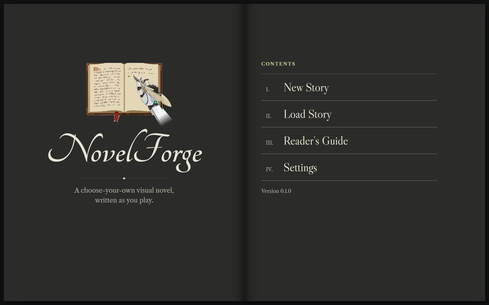
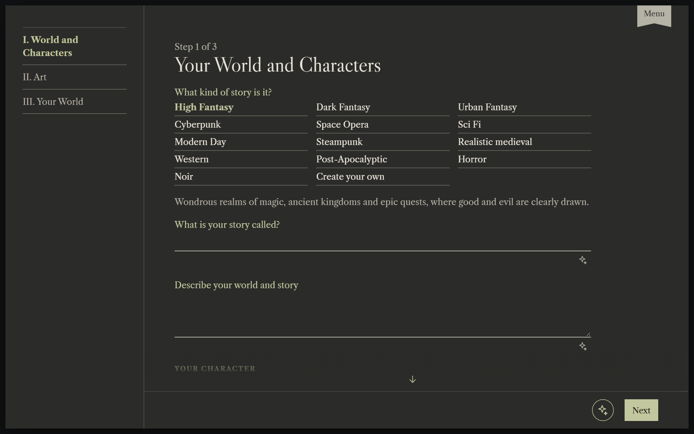
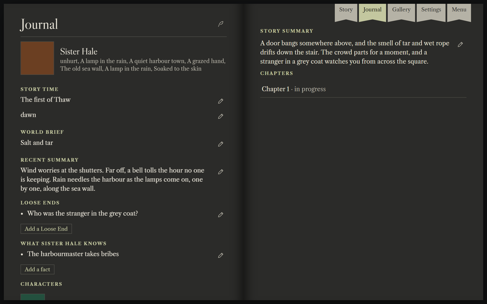
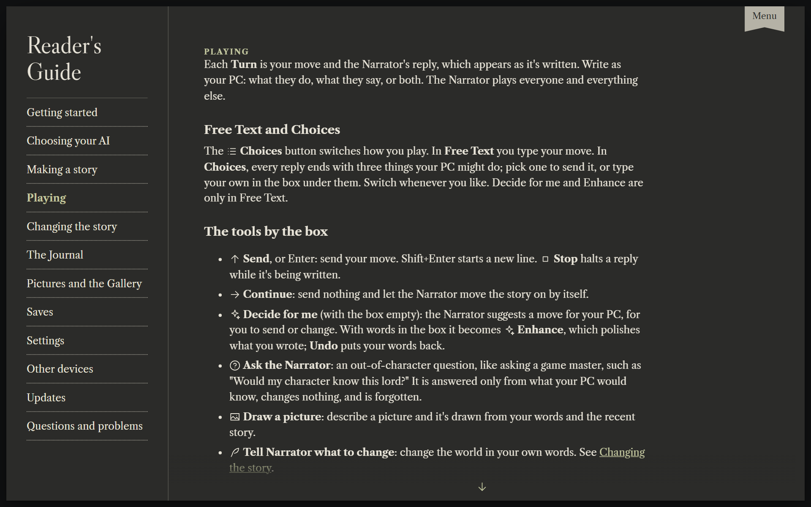
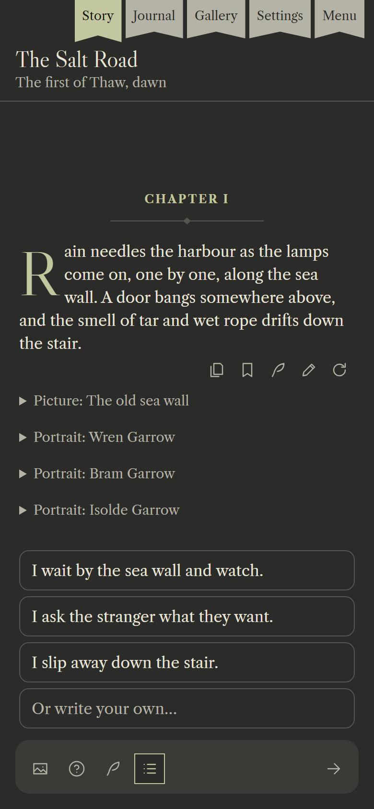

<p align="center"></p>

<h1 align="center">NovelForge</h1>

<p align="center">A choose-your-own visual novel, written as you play.</p>

NovelForge is a single-player story game. You build a world and a character, then act and speak only as that character, while an AI plays the Narrator: it runs the story, voices everyone else, keeps track of the world, and rolls the dice when what you try could fail. An image AI draws the Cover, portraits and scenes as the story goes.

It runs on your own computer and talks to models you choose. Bring an OpenAI-compatible text API (OpenRouter, DeepInfra, a local server) and, for pictures, OpenRouter, Wiro or your own ComfyUI.

<p align="center"></p>

## Features

Most AI roleplay is one long chat with a model that agrees with everything, forgets what happened an hour ago and writes your character's lines for you. NovelForge is built as a game instead, with the AI as its storyteller.

- **Your character is yours.** The Narrator never speaks or acts for your PC, never moves them somewhere or skips time on its own, and stops each reply at the moment your PC would answer or choose. Type your move, or pick from three Choices.
- **Things can go wrong.** Left to itself, an AI lets everything work. When your PC tries something risky, the Narrator sets how hard it is first, then a hidden die decides, so a bold plan can fail and a long shot can come off.
- **The world keeps secrets.** The New Story wizard builds a full world from your Theme, ideas and characters, with its own history, places and secret Plot Threads, which you uncover by playing. Write it all yourself, or let the Narrator fill in what you leave empty.
- **It remembers.** The story is kept as structured state, not just chat history: who your PC has met and what they know, Loose Ends still open, the time and date, and short Old Memories of everything older. You read and edit it all in the Journal, which holds only what your PC knows, and the Narrator gets what it needs each Turn, so a long story stays straight.
- **Nothing is final.** Every Message keeps a full Snapshot of the story, so you can rewrite, edit or regenerate a reply, step back to any point at once, or branch off into a copy and try another path. Tell the Narrator to change the world in your own words, or switch AI in the middle of a story.
- **Pictures that stay in character.** A Cover, a portrait for each person, kept up to date as their looks change, and a picture whenever the scene changes or you ask for one. Image models that take reference pictures draw scenes from the portraits, so faces stay the same, and the Gallery lets you redraw, nudge or replace any picture with your own.
- **Yours, on your computer.** No account and no subscription. Each story is one file on your own disk that you can duplicate, export and import, and you choose the AI, from a cheap hosted one to one on your own graphics card.

## Screenshots

<table>
  <tr>
    <td width="50%"><br><sub>New Story: pick a Theme and describe as much or as little as you like.</sub></td>
    <td width="50%"><br><sub>The Journal: what your character knows, Loose Ends and Chapters, all editable.</sub></td>
  </tr>
  <tr>
    <td width="50%"><br><sub>The Reader's Guide explains every part of the app.</sub></td>
    <td width="50%" align="center"><br><sub>Playing on a phone, in Choices mode.</sub></td>
  </tr>
</table>

## Quick Install

Download your system's file from the [Releases](https://github.com/brianh014/novelforge/releases/latest) page, where the files are listed under **Assets** at the bottom. Each system has two, and most people want **NovelForge**; the Server is for running it on another machine and playing from your other devices.

- **NovelForge** is the app: it opens in your browser, for this computer only, and you end it with Quit in the Menu.
- **NovelForge Server** serves the whole network and opens no browser, so it runs headless too. Its log goes to the terminal, and stopping it (closing the window, or Ctrl+C) stops the server. Browse to it from any device at `http://<its address>:4600/`; it lists its addresses as it starts.

Both use port 4600. Once it's open, [connect an AI](#connecting-an-ai) in **Settings**, then read the **Reader's Guide** on the Menu for how to play. The downloads aren't signed yet, so Windows and macOS warn the first time you open one.

### Windows

1. Download `NovelForge-Windows.zip` (or `NovelForge-Server-Windows.zip`).
2. Right-click the zip, choose **Extract All**, and extract it into a folder of its own, such as `Documents\NovelForge`. Don't open the program from inside the zip: Windows runs it from a temporary folder then, and your Saves would be lost. Your Saves, Settings and logs are kept in that folder, beside the program.
3. Open `NovelForge.exe`. If Windows says it protected your PC, choose **More info**, then **Run anyway**.

### macOS

1. Download `NovelForge-Mac-AppleSilicon.tar.gz` for an M-series Mac, or `NovelForge-Mac-Intel.tar.gz` for an Intel one (the `NovelForge-Server-Mac-…` files for the Server). To tell which you have, open the Apple menu → **About This Mac**: **Chip** says Apple M… on an M-series Mac, and **Processor** says Intel on an Intel one.
2. Open the file to unpack `NovelForge.app`, and drag it to Applications. Your Saves, Settings and logs are kept in `~/Library/Application Support/NovelForge`.
3. Open it. The first time, macOS refuses it: close that message, then open **System Settings → Privacy & Security**, choose **Open Anyway** beside NovelForge, and confirm. **Open Anyway** only shows up after you've tried to open it once.

### Linux

1. Download and unpack it into a folder of its own, for x64. On a machine with no desktop, such as a server reached over SSH, use the Server: `NovelForge-Server-Linux.tar.gz` in place of `NovelForge-Linux.tar.gz` below.

   ```bash
   mkdir -p ~/NovelForge && cd ~/NovelForge
   curl -fL -o NovelForge-Linux.tar.gz https://github.com/brianh014/novelforge/releases/latest/download/NovelForge-Linux.tar.gz
   tar -xzf NovelForge-Linux.tar.gz && rm NovelForge-Linux.tar.gz
   ```

2. Your Saves, Settings and logs are kept in that folder, beside the program.
3. Run `~/NovelForge/NovelForge`, which opens your browser with `xdg-open` (if none opens, go to `http://127.0.0.1:4600/`). For the Server, run `~/NovelForge/NovelForge-Server` and browse to one of the addresses it prints.

#### Running the Server in the background

To keep the Server running after you log out, and start it again when the machine restarts, make it a systemd service. Run this as the user who unpacked it, from any folder:

```bash
sudo tee /etc/systemd/system/novelforge.service >/dev/null <<EOF
[Unit]
Description=NovelForge Server
After=network-online.target
Wants=network-online.target

[Service]
ExecStart=$HOME/NovelForge/NovelForge-Server
User=$(id -un)
Restart=on-failure

[Install]
WantedBy=multi-user.target
EOF
sudo systemctl daemon-reload
sudo systemctl enable --now novelforge
```

| To | Run |
| --- | --- |
| See whether it's running, and its addresses | `systemctl status novelforge` |
| Follow its log | `journalctl -u novelforge -f` (also kept in `~/NovelForge/logs`) |
| Restart it | `sudo systemctl restart novelforge` |
| Stop it, and keep it from starting at boot | `sudo systemctl disable --now novelforge` |

### Connecting an AI

NovelForge has no AI of its own, so it needs a key from an AI service before it can write. The easiest is [OpenRouter](https://openrouter.ai), which is already chosen in Settings. You pay it for what you use, a few cents a Turn. To try it for free, see [Google AI Studio](#a-free-key-google-ai-studio) below.

1. Sign up at [openrouter.ai](https://openrouter.ai), open [Credits](https://openrouter.ai/settings/credits) and add a few dollars.
2. Open [Keys](https://openrouter.ai/settings/keys), choose **Create Key**, give it any name, and copy the key it shows. It's shown only once, so paste it somewhere safe too.
3. In NovelForge, open **Settings → Text**. Paste the key into **Text API key**, choose a **Text model** and press **Test text**. Two good choices right now write about as well as each other: [MiMo V2.6 Pro](https://openrouter.ai/xiaomi/mimo-v2.6-pro) (`xiaomi/mimo-v2.6-pro`), a good balance of cost and writing, and [DeepSeek V4.1 Flash](https://openrouter.ai/deepseek/deepseek-v4.1-flash) (`deepseek/deepseek-v4.1-flash`), which costs much less a Turn. Try both on the same story and keep the one you like.
4. For pictures, open **Settings → Images**, choose **OpenRouter**, paste the same key into **Image API key**, choose an image model and press **Test image**. Try Seedream 5.5, or Nano Banana 2.1 for a little better quality. If you have a graphics card, your own ComfyUI draws for free (see [Recommended settings](#images-your-own-comfyui)). Pictures are optional: without them the story is text only.

### A free key: Google AI Studio

[Google AI Studio](https://aistudio.google.com) gives a free key with a Google account, no card needed. Sign in, choose **Get API key**, then in **Settings → Text** choose **Google AI Studio**, paste the key, save, and pick a Gemini Flash model. The free tier limits how many Turns a day you get, and Google may use what you send, your story among it, to improve its products. The same key draws pictures with Nano Banana under **Settings → Images → Google AI Studio**, but pictures aren't free: turn on billing in AI Studio first.

### Updating

When a new version is out, a notice at the top of the screen says so, and **Settings → Updates** can check at any time. Choose **Install**, and NovelForge downloads it, restarts and comes back to the same page, on every system and for the Server too. Your Saves and Settings stay as they are, and if the new version fails to start, the old one comes back. To check, NovelForge asks GitHub for the newest release every few hours; nothing else is sent.

You can also update by hand: download the new version and unpack it over the old one, with NovelForge closed (on a Mac, replace `NovelForge.app` in Applications; for a systemd service, `sudo systemctl stop novelforge` first and `start` it after).

## Using NovelForge

The **Reader's Guide** on the Menu explains everything in the app: making a story, playing, changing what happened, the Journal, pictures, Saves, every setting, and answers to common problems.

## Running from source

You need [Bun](https://bun.sh) 1.4 or later.

```bash
bun install
bun start
```

`bun start` serves NovelForge on port 4600 and opens it in your browser. Then [connect an AI](#connecting-an-ai) in **Settings**. To update, run `git pull` and `bun install`. Your Saves, Settings and logs stay in the project folder, which git ignores.

To try it with no model and no key, run it with stand-ins:

```bash
bun src/main.ts --fake --open
```

| Option | What it does |
| --- | --- |
| `--fake` | Uses a stand-in Narrator and image model, with their own Saves and Settings under `fake/`. |
| `--open` | Opens the browser once the server is up. |
| `--app` | Runs as the desktop app: this computer only, with Quit in the Menu. |
| `--server` | Runs as a server for the network, even from a built download. |
| `PORT` | The port to listen on (default `4600`). |
| `HOST` | The address to listen on (default `0.0.0.0` for a server, `127.0.0.1` for the app). |

`bun run install-launcher` adds a NovelForge shortcut to your desktop or app menu. `bun run release` builds the one-file downloads into `dist/release`. `bun run publish-release` tags the commit with `package.json`'s version, builds the downloads and uploads them as a GitHub release with the [GitHub CLI](https://cli.github.com) (`gh`), signed in as you; a version with a hyphen, such as `0.2.0-alpha.1`, is a pre-release, which Install never offers. `bun run try-update` tries Install before a release: it builds this code as an old 0.0.1 copy and as the new version, and starts the old one with `--fake` on port 4660 against a stand-in release, so choosing Install brings it back as the new version.

> **A server on the network has no accounts.** Anyone who can reach it can play, change Settings and spend your saved keys. Keep it on a network you trust, or set `HOST=127.0.0.1`.

## Recommended settings

### Text: a hosted API

Use a hosted text API, such as OpenRouter (see [Connecting an AI](#connecting-an-ai)), [NanoGPT](https://nano-gpt.com), Google AI Studio or any other OpenAI-compatible provider. Every Turn sends the Narrator the newest Messages in full, plus the world, the Journal and the Old Memories, so a long story's prompt grows past 30,000 tokens. Large hosted models take all of it, keep the story straight and return the Narrator's JSON first time, for pennies a Turn. Staying on one provider keeps its prompt cache, which makes each Turn cheaper.

A local model works too: choose **Local / OpenAI server** and give the address of Ollama (`http://localhost:11434/v1`), LM Studio (`http://localhost:1234/v1`) or another OpenAI-compatible server. It suits short stories, play with nothing leaving your computer, and trying things out. A 10 GB GPU fits a model of about 12B at Q4 with a 16,000-token context, so the Narrator sees much less of a long story, and a Turn can take a minute. To get the most from it:

- Set the context length in the server, such as `PARAMETER num_ctx 16384` in an Ollama Modelfile. Ollama's default is small, and it cuts the prompt without saying so.
- In Settings → Text, set **Longest reply, in tokens** to about 3000 and **Recent Messages** to 40. The server keeps room in its context for the longest reply, so a high limit leaves less for the story.
- Leave the server's memory settings at their defaults first. On an RTX 3080, Ollama's `q8_0` KV cache made Gemma 4 12B about ten times slower.

### Images: your own ComfyUI

Use **Local (ComfyUI)** if you have a GPU for it. NovelForge draws a lot: the Cover, a portrait for each person, a Scene Image whenever the scene changes, pictures on request, and every redraw. On a paid image API each one costs money, and on your own ComfyUI they are free. Choose FLUX.2 or Qwen Image 2.1 in Simple Mode to keep faces the same from picture to picture, as SD 1.5 and SDXL can't use portraits.

ComfyUI keeps its model on the GPU between pictures. If a local text model or anything else needs the GPU too, turn on **Free GPU memory after each picture**. Use OpenRouter, [NanoGPT](https://nano-gpt.com) or [Wiro](https://wiro.ai) for pictures only if you have no GPU for ComfyUI: try Seedream 5.5, or Nano Banana 2.1 for a little better quality. On Wiro, set the project to API key only, and choose the model from the list in Settings, such as `bytedance/seedream-5-5`.

## Development

Bugs and ideas go in [Issues](https://github.com/brianh014/novelforge/issues), and security problems to [a private advisory](https://github.com/brianh014/novelforge/security/advisories/new) (see [`SECURITY.md`](SECURITY.md)).

```bash
bun run check   # lint and format check, typecheck, unit tests
bun run e2e     # Playwright end-to-end tests, against the stand-ins
bun run format  # format every file
```

The code is TypeScript on Bun, with a React page bundled by Bun itself. Start with:

- [`GLOSSARY.md`](GLOSSARY.md): the words the code and the UI use, such as Turn, Snapshot and Scene Image.
- [`docs/adr/`](docs/adr/): the decisions behind the design, and why.
- [`docs/spec.md`](docs/spec.md): the original specification.
- [`CONTRIBUTING.md`](CONTRIBUTING.md): how to set up, test and send a change.

## License

Copyright © 2026 Brian Holt. NovelForge is free software under the [GNU Affero General Public License 3.0](LICENSE). You may use, change, share and sell it. If you share a changed version, or run one as a server that other people use, you must offer them its source under the same license.
